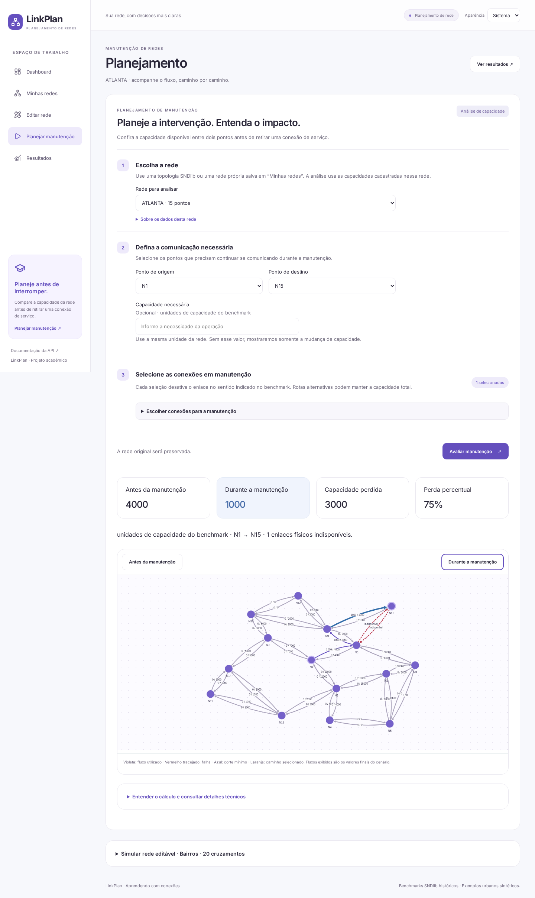
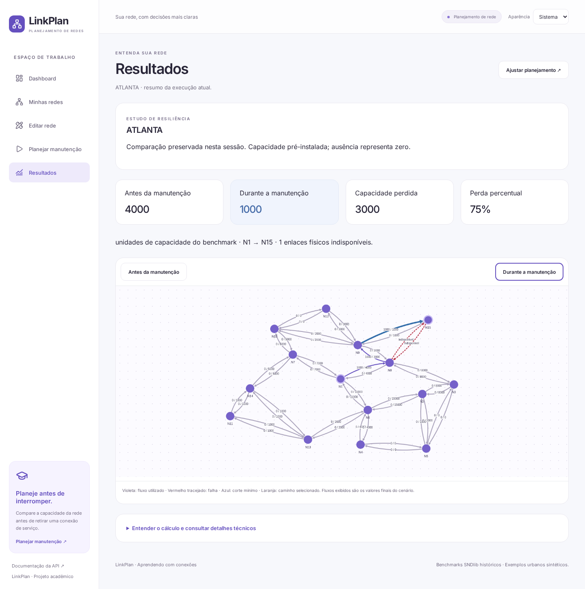

<p align="center">
  
</p>

<p align="center">
  <a href="https://github.com/Pedroltz/LinkPlan/actions/workflows/ci-cd.yml"></a>
  
  
  
  
</p>

# LinkPlan

O estudo principal analisa a resiliência de redes de computadores: em **Planejamento**, carregue os benchmarks SNDlib, escolha origem/destino e enlaces físicos indisponíveis. Compare a capacidade original e remanescente e os cortes mínimos. Consulte [procedência e hipóteses](datasets/case-studies/README.md). Três redes residuais sintéticas de tamanhos diferentes ficam em **Minhas redes** para testar fluxo máximo e capacidade perdida durante a apresentação.

Aplicação de Teoria dos Grafos para analisar a resiliência de redes de telecomunicações: calcular a capacidade máxima entre dois pontos e quantificar sua redução após falhas de enlaces físicos. O núcleo é uma implementação própria de **Ford-Fulkerson com BFS (Edmonds-Karp)** em C#, com caminhos aumentantes, residual e corte mínimo.

[Começar](#executar-com-docker) · [Ver a interface](#por-dentro-do-linkplan) · [Planejar manutenção](#planejamento-de-manutenção) · [Documentação](#documentação-do-projeto) · [Equipe](#integrantes)

## O que você pode explorar

| Recurso                        | Na prática                                                                                      |
| ------------------------------ | ----------------------------------------------------------------------------------------------- |
| **Planejamento de manutenção** | Selecione enlaces indisponíveis e compare a capacidade original com a remanescente.             |
| **26 topologias SNDlib**       | Explore benchmarks com fonte, unidades e hipóteses documentadas.                                |
| **Editor visual de redes**     | Crie pontos e conexões, defina capacidades e importe ou exporte JSON.                           |
| **Algoritmo passo a passo**    | Examine caminhos aumentantes, gargalos, fluxos, residual e corte mínimo.                        |
| **Resultados comparáveis**     | Consulte perda de capacidade, utilização das arestas e atendimento a uma capacidade necessária. |
| **Interface adaptável**        | Navegue em desktop ou celular com temas claro, escuro e do sistema.                             |

## Por dentro do LinkPlan

Capturas reais da aplicação executada localmente com os dados de demonstração.

### Um ponto de partida para explorar redes


### Planeje uma manutenção e compare o impacto





## Experimente em poucos passos

1. Inicie a aplicação com Docker e abra **http://localhost:4200**.
2. Acesse **Planejamento** e escolha uma das topologias do catálogo.
3. Defina a origem e o destino, selecione os enlaces em manutenção e clique em **Avaliar manutenção**.
4. Compare os cenários e explore os caminhos, a rede residual e os cortes mínimos.

As capacidades representam o modelo de cada estudo, não medições das redes atuais. Abilene e Atlanta usam capacidades pré-instaladas; as demais topologias usam a hipótese documentada de um menor módulo positivo por enlace. Consulte a [procedência e as hipóteses dos benchmarks](datasets/case-studies/README.md). Os exemplos urbanos permanecem disponíveis como apoio didático.

## Documentação do projeto

| Material                                             | Conteúdo                                              |
| ---------------------------------------------------- | ----------------------------------------------------- |
| [Proposta](docs/PROPOSTA.md)                         | Problema, objetivos e escopo acadêmico.               |
| [Benchmarks SNDlib](datasets/case-studies/README.md) | Origem, unidades, sentidos e política de capacidades. |
| [Datasets urbanos](datasets/README.md)               | Exemplos sintéticos e formato de importação.          |
| [Validação](docs/VALIDACAO.md)                       | Registros de testes e resultados experimentais.       |
| [Relatório técnico](docs/RELATORIO.html)             | Modelagem, arquitetura, algoritmo e metodologia.      |
| [Apresentação](docs/APRESENTACAO.html)               | Material em HTML para apresentação do projeto.        |
| [Roteiro de entrega](docs/ENTREGA.md)                | Organização da demonstração e da entrega.             |
| [Deploy no Render](deploy/render/README.md)          | Configuração de publicação e infraestrutura.          |

O projeto se chamava **FlowCity**. Nomes internos .NET, banco SQLite e variáveis `FLOWCITY_*` foram preservados para manter a compatibilidade.

## Tecnologias e organização

- Backend: .NET 10, ASP.NET Core Web API, C#, Entity Framework Core e SQLite; Swagger/OpenAPI em `/swagger`.
- Mapster 7.4.0 para conversão dos contratos da API, projeção dos resumos e atualização de campos. Configuração em `backend/FlowCity.Api/Mappings/GraphMappingConfig.cs`; coleções rastreadas pelo EF são sincronizadas por ID para preservar suas identidades.
- Fluxo da API: `GraphsController` → `IGraphService` / `GraphService` → `IGraphRepository` / `GraphRepository` → SQLite. O controller trata contratos HTTP; o service valida e coordena as operações; o repository concentra consultas EF e persistência. Os mapeamentos de domínio estão em `FlowCity.Application/Mappings/GraphMappingRegister.cs` e os contratos HTTP permanecem na API.
- Injeção de dependência centralizada em `FlowCity.Api/Configuration/DependencyInjectionConfig.cs`, ativada por `AddFlowCity`. Services, repositories, validator, `IMaxFlowAlgorithm`, `IMapper` e inicializador do banco usam escopo por requisição; os perfis e a configuração compilada do Mapster são compartilhados como singletons. A carga inicial recebe suas dependências pelo construtor e é executada em um escopo na inicialização.
- FluentValidation 12.1.1 para regras do grafo em `GraphValidator : AbstractValidator<Graph>`, compartilhadas pela API, carga inicial e algoritmo através de `IValidator<Graph>`. Falhas de validação retornam HTTP 400.
- Frontend: Angular 21, TypeScript, Angular Material e Cytoscape.js.
- Testes: xUnit, com testes numéricos, invariantes e integração HTTP usando SQLite temporário.

```text
backend/
  FlowCity.Domain/          Entidades e resultados do algoritmo
  FlowCity.Application/     Validação e Ford-Fulkerson com BFS
  FlowCity.Infrastructure/  Mapeamento e persistência EF Core/SQLite
  FlowCity.Api/             Controllers, DTOs, DI, OpenAPI e carga inicial
  FlowCity.Tests/           Testes unitários, integração e experimento
frontend/src/app/           Rotas, estado compartilhado, serviço HTTP e páginas Angular
datasets/                   Redes de teste, catálogo SNDlib e documentação
scripts/                    Gerador reproduzível dos datasets
```

Em `datasets/case-studies`, o catálogo selecionável contém 26 topologias
SNDlib e seus XML de origem. As três redes de teste em JSON ficam separadas
desse catálogo.

Não há bibliotecas de cálculo de grafos, CQRS, MediatR ou serviços intermediários que apenas encaminham chamadas. Cytoscape é usado exclusivamente para visualização e interação.

## Executar com Docker

Pré-requisito: Docker com Compose.

```sh
docker compose up --build
```

Abra **http://localhost:4200**. API e Swagger: **http://localhost:5080/swagger**. O frontend encaminha `/api` ao backend por Nginx, sem configuração de CORS. O volume `flowcity-data` preserva as redes entre reinicializações. `docker compose down` para os serviços sem excluir os dados. Aguarde a inicialização da API antes de abrir a aplicação.

## Executar localmente

Pré-requisitos: SDK .NET 10, Node.js 24 e npm. Angular 21 é compatível com Node 24 e TypeScript 5.9, conforme a [tabela oficial](https://angular.dev/reference/versions). A configuração da API segue as APIs documentadas de [ASP.NET Core](https://learn.microsoft.com/en-us/aspnet/core/tutorials/first-web-api?view=aspnetcore-10.0).

Na raiz, em um terminal:

```sh
dotnet restore backend/FlowCity.sln
dotnet run --project backend/FlowCity.Api --urls http://localhost:5000
```

Em outro terminal:

```sh
cd frontend
npm ci
npm start
```

Abra **http://localhost:4200**. O proxy de desenvolvimento envia `/api` e `/swagger` para a porta 5000. Para validar a compilação de produção: `npm run build` na pasta `frontend`.

## Banco de dados

O SQLite é criado automaticamente no primeiro início com `EnsureCreatedAsync`; nenhuma ferramenta externa nem comando de migração é necessário. Por padrão, o arquivo `flowcity.db` é relativo ao diretório de execução da API. Para escolher uma localização, defina `ConnectionStrings__FlowCity`, por exemplo `Data Source=C:/dados/flowcity.db` (o diretório deve existir). No Docker, o arquivo fica em `/data/flowcity.db`.

As três redes sintéticas de teste são inseridas quando o banco é criado. Excluir todas as redes não as recria automaticamente. Para recuperá-las, importe os JSON pela interface. Ao iniciar com um banco existente, a aplicação renomeia os três exemplos antigos de cidade e rotula os vértices como `s`, `a`, `b`, …, `t`, preservando capacidades e conexões editadas. O catálogo SNDlib é fornecido separadamente pela API e não é gravado no banco. O banco usa tabelas relacionadas para redes, vértices e arestas, com chaves compostas por rede e ID. Exclusões de redes removem suas entidades dependentes. Uma edição é persistida em uma única operação transacional do EF Core.

Não há migrações de esquema nesta versão de demonstração. Ao alterar o modelo de persistência, exporte suas redes e use um novo arquivo SQLite, ou implemente uma migração antes de reutilizar o banco antigo.

## Interface e navegação

O frontend possui cinco páginas carregadas sob demanda pelo Angular Router:

- `/dashboard`: totais reais das redes salvas, redes disponíveis e ações rápidas.
- `/redes`: busca, seleção, criação, exclusão e importação/exportação JSON. A exportação e a exclusão usam a rede atual indicada na página.
- `/editor`: canvas Cytoscape, metadados, vértices, arestas e capacidades. Uma lista permite selecionar elementos também pelo teclado.
- `/simulacoes`: origem/destino, execução, caminhos aumentantes destacados e visualizações original, fluxo e residual.
- `/resultados`: fluxo máximo, tempo, iterações, gargalos dos caminhos e utilização de cada aresta.

O `GraphApi` concentra os contratos HTTP existentes. O `WorkspaceState` mantém a rede em edição, a seleção e o resultado ao navegar entre páginas. O canvas é recriado a partir desse estado. Recarregar a aplicação não restaura resultados da sessão. Não há datas nem histórico persistente nos contratos atuais; por isso a interface não inventa redes recentes ou métricas históricas. Arestas saturadas são identificadas separadamente de um corte mínimo.

Inter é servida localmente por `@fontsource/inter`. Os ícones Lucide são importados individualmente de `@lucide/angular`. O layout inclui menu móvel, foco visível, link para pular ao conteúdo, mensagens de estado e suporte a movimento reduzido.

## Aparência

O seletor **Aparência** no cabeçalho oferece Claro, Escuro e Sistema. A preferência é salva localmente no navegador; Sistema acompanha a configuração do dispositivo. Se o armazenamento estiver bloqueado, a alternância continua funcionando na sessão. A paleta escura adapta formulários, tabelas, indicadores e grafos, preservando as cores semânticas de falhas, caminhos e cortes. A mudança de tema não altera resultados nem posições dos nós. Para validar com a aplicação ativa: `npm run test:theme` em frontend.

## Editor de redes

O editor oferece três tarefas: **Adicionar ponto**, **Criar conexão** e **Editar itens**. Os pontos recebem identificadores automáticos; códigos manuais permanecem disponíveis em uma seção avançada. A capacidade deve ser informada explicitamente, na unidade da rede registrada na descrição. A opção de volta cria duas arestas independentes com a mesma capacidade; editar uma direção não altera a outra.

Selecionar um ponto ou uma conexão no mapa abre sua edição. A lista pesquisável oferece a mesma seleção pelo teclado; em telas pequenas, o campo de edição recebe foco. **Aplicar à rede** altera o rascunho; **Salvar rede** grava no banco. Excluir um ponto exige confirmação e remove também suas conexões. **Analisar esta rede** salva e leva diretamente à análise da rede editável, sem misturar um benchmark anteriormente selecionado. O cálculo também continua disponível em uma seção opcional do editor.

Para validar a construção e edição pelo navegador: `npm run test:editor` em frontend, com os servidores ativos.

## Planejamento de manutenção

O fluxo principal segue três etapas: escolher a topologia, definir origem/destino e selecionar enlaces em manutenção. A capacidade necessária é opcional e usa a unidade da rede escolhida. Quando informada, o resultado mostra capacidade suficiente ou insuficiente no modelo, com margem ou déficit, e avisa quando a rede original já não atende ao requisito. Sem esse valor, apresenta somente a comparação de capacidades. Valores negativos ou zero são rejeitados; trocar de rede limpa o requisito para evitar misturar unidades. Uma manutenção pode não reduzir o fluxo máximo quando há rotas alternativas. Os detalhes de algoritmo e procedência ficam em seções expansíveis.

As redes do catálogo continuam sendo exemplos documentados. A avaliação não autoriza intervenções em infraestrutura real sem validação de roteamento e tráfego concorrente.

## Estudos de resiliência

Em **Minhas redes**, use **Explorar benchmarks** para abrir **Planejar manutenção**. Selecione uma topologia e os extremos. O seletor de enlaces mostra `↔` para conexões bidirecionais e `→` para enlaces direcionados. A manutenção desativa os sentidos indicados pela topologia, sem alterar os arquivos originais. Compare o cenário original com o cenário de falhas e examine caminhos, residual, corte mínimo e utilização. **Resultados** preserva essa comparação durante a sessão; recarregar a aplicação reinicia o estado.

“Criar cópia editável” salva uma rede independente, com atribuição e unidade na descrição. As ferramentas existentes de edição e JSON continuam disponíveis. Redes editáveis usam o rótulo genérico “unidades de capacidade”; a unidade específica deve ser consultada na descrição. Resultados de redes editáveis e de benchmarks são apresentados separadamente.

Novos endpoints, sem migração do SQLite:

- `GET /api/case-studies`: catálogo e procedência das 26 topologias SNDlib.
- `GET /api/case-studies/{id}`: benchmark imutável com vínculos de enlaces físicos.
- `POST /api/case-studies/{id}/resilience`: recebe `source`, `sink`, `failedLinkIds`; retorna `baseline`, `scenario`, `baselineCut`, `scenarioCut`, `lostCapacity` e `lossPercent`.

IDs de estudo inexistentes retornam 404; extremos inválidos ou enlaces desconhecidos, 400. IDs de falha duplicados são tratados uma vez. A perda percentual é `null` quando o fluxo original é zero. Cortes são extraídos do residual, sem inferir que qualquer aresta saturada seja um corte.

O estado de resiliência é independente da rede pessoal em edição. O algoritmo permanece inalterado. O serviço de aplicação coordena cópias dos benchmarks; os controllers tratam HTTP.

Na pasta frontend: `npm run test:resilience`. Na raiz, com a API ativa: `node scripts/experiment-resilience.mjs`. O experimento avalia falhas individuais e grava `artifacts/resilience-experiment.json`; `FLOWCITY_API_URL` e `FLOWCITY_RESILIENCE_OUTPUT` permitem escolher API e arquivo de saída. O produto permite seleção manual de falhas, sem classificação automática de criticidade.

Na raiz, `python scripts/import-sndlib.py --verify` confere os dados offline; sem argumentos reconstrói os JSON usando XML locais e checksums; `--download` obtém novamente a revisão fixada. Python é necessário somente para essa manutenção dos datasets, não para executar a aplicação.

## Roteiro das redes de teste

1. Em **Minhas redes**, abra **Rede residual pequena · 6 nós** e escolha `s` como origem e `t` como destino.
2. Execute o fluxo máximo. O valor esperado é **23**; o corte mínimo tem capacidade 23.
3. Abra **Resultados** e examine o fluxo, o corte e os caminhos aumentantes.
4. Em **Planejamento**, alterne para **Residual do benchmark** para ver as arestas reversas criadas pelo algoritmo. Elas permitem cancelar fluxo e não são ligações do grafo original.
5. Repita com **Rede residual média · 20 nós** e **Rede residual grande · 100 nós** para comparar instâncias maiores.
6. Para testar o efeito de falhas físicas de telecomunicações, use **Explorar benchmarks** e selecione uma topologia do catálogo SNDlib.

Alterar capacidades, estrutura ou extremos invalida o resultado anterior. Arrastar vértices altera apenas o posicionamento. Trocar de rede avisa sobre alterações não salvas. Importar JSON cria e salva uma nova rede e aceita o formato mínimo mostrado em `datasets/README.md`.

## Modelagem das redes de teste e algoritmo

Nas redes sintéticas de teste, vértices usam rótulos simples como `s`, `a`, `b` e `t`; arestas direcionadas têm capacidades inteiras abstratas. Vias paralelas e sentidos opostos são independentes e possuem IDs próprios. Nos estudos SNDlib, vértices, sentidos e unidades seguem a topologia selecionada; capacidades e hipóteses de cada rede estão documentadas em `datasets/case-studies/README.md`.

Em todos os casos, o fluxo é conservado nos vértices intermediários. Laços são aceitos, mas não ajudam a transportar fluxo entre extremos diferentes.

`FordFulkerson.Calculate` começa com fluxo zero em cada execução, independentemente de valores importados. Para cada via cria dois objetos residuais emparelhados: direto, com capacidade original, e reverso, inicialmente zero. A BFS encontra o caminho aumentante com menor número de arestas; o gargalo é o menor resíduo desse caminho. Subtrair o gargalo dos arcos percorridos e adicioná-lo aos pares permite também desfazer atribuições anteriores. A busca termina quando o destino deixa de ser alcançável.

O resultado inclui valor total, fluxo e capacidade original de cada via, resíduo direto, todos os arcos residuais diretos/reversos, cada caminho com resíduos **anteriores** ao aumento, gargalo, fluxo adicionado, número de iterações e tempo. Uma reversa nunca é confundida com uma via original no sentido contrário. O grafo de entrada não é modificado; resultados são transitórios e o fluxo persistido permanece zero.

Edmonds-Karp tem complexidade temporal **O(V E²)** e estrutura de trabalho **O(V + E)**. O histórico solicitado acrescenta memória proporcional à soma dos comprimentos dos caminhos encontrados, podendo chegar a **O(V² E)**. Capacidades individuais usam `int`; fluxos e totais usam `long` para evitar estouro na soma. O tempo medido inclui construção da rede residual, BFS, atualizações e construção do resultado; exclui validação, banco, HTTP e desenho.

## API

| Método | Endpoint                    | Função                                   |
| ------ | --------------------------- | ---------------------------------------- |
| GET    | `/api/graphs`               | Resumos das redes                        |
| GET    | `/api/graphs/{id}`          | Rede completa                            |
| POST   | `/api/graphs`               | Criar/importar rede                      |
| PUT    | `/api/graphs/{id}`          | Atualizar rede completa                  |
| DELETE | `/api/graphs/{id}`          | Excluir rede                             |
| POST   | `/api/graphs/{id}/max-flow` | Calcular com `{"source":"S","sink":"T"}` |

POST e PUT recebem `name`, `description` opcional, `nodes` e `edges`. Consulte os esquemas no Swagger. Dados inválidos retornam HTTP 400; redes inexistentes, 404; criação, 201; exclusão, 204. Origem igual ao destino é rejeitada. Sem caminho positivo, o resultado válido é zero com zero iterações.

## Testes e análise experimental

```sh
dotnet test backend/FlowCity.sln -c Release
```

Testes numéricos cobrem grafo simples, fluxo conhecido 23, múltiplos caminhos, gargalo, ausência de caminho, capacidade zero, desconexão, ciclos, isolamento, laços, vias paralelas/antiparalelas, cancelamento residual e soma acima de `int.MaxValue`. Verificam limites de capacidade, conservação, resíduos reversos, ausência de mutação e igualdade entre fluxo e capacidade do corte mínimo extraído do residual. Testes HTTP verificam criação, edição, leitura persistida em novo contexto, remoção, importação mínima, validação, datasets e OpenAPI.

Para reproduzir o teste de demonstração no Chromium, com backend e frontend já em execução e os datasets originais disponíveis, execute na pasta `frontend`:

```sh
npx playwright install chromium
npm run test:e2e
```

O teste usa cópias temporárias das redes e as exclui ao terminar, preservando os datasets originais. Verifica edição repetida, navegação com estado compartilhado, cálculo, caminhos, rede residual, importação/exportação, busca, recuperação de erro e as cinco páginas em tela móvel. Grava capturas em `artifacts/`. A URL padrão é `http://localhost:4200`; pode ser substituída pela variável `FLOWCITY_URL`. Veja o [registro de validação e resultados experimentais](docs/VALIDACAO.md).

Para gerar o CSV experimental, em PowerShell na raiz:

```powershell
$env:FLOWCITY_EXPERIMENT_OUTPUT = "$PWD/artifacts/experimento.csv"
dotnet test backend/FlowCity.Tests -c Release --filter FullyQualifiedName~ExperimentTests --logger "console;verbosity=detailed"
```

Em Linux/macOS:

```sh
FLOWCITY_EXPERIMENT_OUTPUT="$PWD/artifacts/experimento.csv" dotnet test backend/FlowCity.Tests -c Release --filter FullyQualifiedName~ExperimentTests --logger 'console;verbosity=detailed'
```

A rotina usa cinco aquecimentos e 30 execuções por instância. Registra vértices, arestas, fluxo máximo, caminhos aumentantes e tempo mediano/mínimo/máximo em milissegundos. Os arquivos são processados em ordem e o tempo exclui leitura do JSON. Reporte CPU, sistema operacional e versão do .NET junto aos valores. Resultados de desempenho variam com JIT, coleta de lixo, carga e hardware; três entradas não demonstram experimentalmente o limite assintótico. A [documentação dos datasets](datasets/README.md) explica origem, fórmulas e limitações.

## Integrantes

Disciplina: **Teoria dos Grafos**. Professor: **Patrick Pedreira**.

Matrículas e contribuições individuais permanecem para preenchimento pelo grupo.

| Nome                       | Matrícula | Contribuição                                                   |
| -------------------------- | --------- | -------------------------------------------------------------- |
| Bruno Bomfim Lima          | 23111399  | Desenvolvimento da API e ajustes no algoritmo                  |
| Pedro Luiz Tunin           | 23110255  | Criar projeto inicial e configurar ambiente de desenvolvimento |
| Raphael Camurri Michelassi | 23110022  | Desenvolvimento do Frontend                                    |
| Bruno Martins              | 1056086   | Levantamento de requisitos                                     |
| Lucas Galli                | 23110821  | Documentação                                                   |
| Christian Decloedt         | 23110176  | Testes e validação                                             |

## Relatório técnico e uso de IA

O [relatório técnico em PDF](output/pdf/LinkPlan-Relatorio-Tecnico.pdf) contém problema, modelagem, algoritmo, arquitetura, metodologia, resultados históricos, limitações, roteiro de demonstração, referências e declaração de uso do **Codex, da OpenAI**. O [original editável em HTML](docs/RELATORIO.html) permite preencher identificação e contribuições individuais antes de regenerar o PDF.

O Codex auxiliou na inspeção dos arquivos, comparação com os requisitos, reformulação do frontend, implementação e testes da resiliência, conversão dos benchmarks e elaboração do relatório e da documentação. O grupo deve complementar o histórico de uso de IA, revisar os conteúdos e registrar sua validação efetiva. Não se atribuem contribuições ou revisões humanas sem confirmação.

Para regenerar o PDF após editar o HTML, com as dependências do frontend e o Chromium do Playwright instalados: `node scripts/build-report.mjs`. O script também produz prévias em `tmp/pdfs/`.

Consulte o [roteiro de entrega e apresentação](docs/ENTREGA.md). A validação de 16/11/2026 e os registros históricos estão separados em `docs/VALIDACAO.md`. A apresentação pelo grupo ainda precisa ser ensaiada.

## Limitações conhecidas

- Capacidades abstratas nas redes sintéticas; os resultados não são previsões de tráfego.
- Até 500 vértices e 5000 arestas por rede; histórico completo pode consumir memória em casos difíceis. Interface prioriza as instâncias de demonstração, sem prometer legibilidade de milhares de arestas simultâneas.
- Resultados não são armazenados no banco; exportação JSON guarda a rede e posições, não o histórico de uma execução.
- Edição colaborativa e controle de concorrência não estão previstos: a última gravação prevalece.
- Não há autenticação: ambiente destinado a demonstração local.
- A navegação interna preserva a rede em edição. Recarregar ou sair da aplicação pode descartar alterações não salvas; o navegador é avisado quando há alterações pendentes. Use **Salvar rede**.
- Docker precisa ser validado em um ambiente com Docker instalado; esta máquina não dispõe desse executável.
